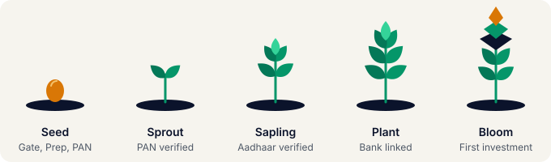
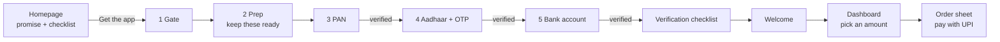

<div align="center">

# 🌱 Sprout 2.0

**From a first visit to a first ₹100 investment, as one calm story.**

An interactive prototype of the Sprout website and app onboarding for first-time investors in India.
React 18 · Vite · plain CSS · English + हिन्दी · no images, no web fonts



</div>

> **Status:** design prototype. Biometrics, KYC verification, UPI payment and the growth chart are **simulated**. Nothing here has been tested with real users, so every decision below is a reasoned hypothesis, not a result.

---

## Contents

1. [The brief](#1-the-brief)
2. [Design approach and decisions](#2-design-approach-and-decisions)
3. [User journey](#3-user-journey)
4. [How the homepage connects to onboarding](#4-how-the-homepage-connects-to-onboarding)
5. [Mascot: Beej](#5-mascot-beej)
6. [Accessibility](#6-accessibility)
7. [Performance](#7-performance)
8. [Hindi and regional languages](#8-hindi-and-regional-languages)
9. [Compliance](#9-compliance)
10. [About the data, and what to test next](#10-about-the-data-and-what-to-test-next)
11. [Run it](#11-run-it)
12. [Project structure](#12-project-structure)
13. [Limits and before launch](#13-limits-and-before-launch)

---

## 1. The brief

Sprout has 40,000 downloads, **9,000** completed KYC and **3,000** made a first investment. The homepage and first-time onboarding need redesigning as **one connected story**, with a mascot that works on both, for a launch in 3 weeks with one front-end developer.

| Requirement | Where to see it |
|---|---|
| Homepage, desktop and mobile | Screen 1, toggle **Homepage: mobile / desktop** under the phone |
| First five onboarding screens | Screens labelled **Onboarding 1/5 to 5/5** |
| One story, website to first investment | Sections 3 and 4 below, and the click-through itself |
| Mascot across homepage and onboarding | Section 5 |
| Accessibility, performance, Hindi/regional | Sections 6, 7, 8 |

---

## 2. Design approach and decisions

**The core idea:** a first-time investor needs three things, in order: *know what is coming, see progress, feel in control.* Every screen does one of those jobs.

### Principles

- **One job per screen.** One field, one button, one reason.
- **Say why.** Every sensitive field explains why it is asked ("Required by law to open an investment account").
- **Show progress, always.** Progress bar, "Step n of 3", and a mascot that visibly grows.
- **Never leave people wondering.** After every step a "verifying, then verified" screen; waiting is a checklist that ticks line by line.
- **Green means money or done.** Emerald is used for nothing else, so people learn it without thinking.
- **Honest numbers.** The growth chart is labelled an illustration, with a dashed "amount invested" line beside it.

### Stakeholder conflicts, and how each was resolved

| Who | What they asked | Decision |
|---|---|---|
| **CEO** | Premium, minimal, no cartoons | Warm cream and navy, flat shapes, lots of space. The mascot has no face, no speech and no bounce |
| **Marketing** | Mascot, video, live ticker, 3 pop-ups, referral banner | **Kept** the mascot and a referral line. **Cut** video, ticker and pop-ups: they add weight (6.2 s load on 4G already) and pull first-timers away from the one action that matters |
| **Compliance** | 12px risk text visible without scrolling; never "guaranteed", "safe", "risk-free" | Risk line sits directly under the main buttons; present on every screen with investment content; a **test fails the build** if a banned word appears in English or Hindi |
| **Developer** | Under 1.5 MB, CSS or small animations, 1 developer, 3 weeks | About 55 KB of JavaScript, no images or fonts, all motion in CSS, small readable codebase |
| **Support** | "Didn't know I needed PAN and Aadhaar" and "thought it crashed" | A **"keep these ready"** checklist on the homepage *and* the prep screen; a **ticking verification checklist** on the wait screen |

### Visual language

Cream `#F6F4EE` background, navy `#0B132B` text, emerald `#047857` for buttons (and `#059669` for graphics), brass `#D97706` for small accents. Cards are white with 1px borders and no shadows. The brand emerald was deepened for button text because white on `#059669` is only about 3.8:1 contrast, which is below AA.

---

## 3. User journey



| # | Screen | What the user does | Beej stage | Design decision |
|---|---|---|---|---|
| H | **Homepage** | Reads the promise, sees what to have ready | Seed (small) | Risk line under the buttons; checklist answers the top support complaint |
| 1 | **Gate** | Enters with biometrics | Seed | Calm, one button |
| 2 | **Prep** | Sees PAN, Aadhaar-linked mobile, bank account | Seed | Same three items, same order as the homepage |
| 3 | **PAN** | Types 10 characters | Seed | Valid format: border flashes emerald, verification starts by itself |
| 4 | **Aadhaar + OTP** | 12 digits, then a 6-digit OTP | Sprout | OTP row slides open once the number is complete |
| 5 | **Bank** | Account number and IFSC | Sapling | Both borders confirm, then it verifies |
| · | **Verification** | Waits about 5 steps | Plant | A checklist ticks off line by line, "keep the app open, your progress is saved" |
| · | **Welcome** | Nothing, it moves on | Bloom | A short, quiet moment of arrival |
| · | **Dashboard** | Drags a slider from ₹100 to ₹10,000 | Bloom | The chart glides to the new amount; labelled as an illustration |
| · | **Order sheet** | Taps to pay | Bloom | Same amount, same chart; ₹ figure is the biggest thing on screen |

The first five **onboarding** screens are Gate, Prep, PAN, Aadhaar and Bank. Verification, welcome, dashboard and the order sheet carry the user from onboarding to the **first investment**.

---

## 4. How the homepage connects to onboarding

The homepage and the app are built to feel like one continuous page, not two products:

| Thread | Homepage | Onboarding | First investment |
|---|---|---|---|
| **Promise** | "Start investing in minutes. Begin with ₹100." | Same words, same ₹100 | ₹100 is the default amount on the slider |
| **Checklist** | PAN, Aadhaar-linked mobile, bank account | The same three, same order, on the prep screen | The same three, verified one by one |
| **Mascot** | Seed Beej beside a short quote | Beej grows one stage per verified step | Full bloom |
| **Look and tone** | Cream, navy, emerald; plain words | Identical | Identical |
| **Risk line** | Directly under the buttons | On the entry and dashboard screens | On the order sheet |
| **Language** | English / हिन्दी toggle | Same toggle, choice remembered | Same |

The homepage button **"Get the app"** opens the app's Gate screen, so the promise people read is the first thing they act on.

> ⚠️ Not yet built: passing the chosen language from website to app (needs a `?lang=hi` link parameter), and a real deep link into the app.

---

## 5. Mascot: Beej

**Beej** (बीज) means *seed*. It is a flat plant with no face and no speech, in the brand colours.


| Stage | When it appears | Meaning |
|---|---|---|
| 🌰 Seed | Homepage, gate, prep, PAN | You are about to begin |
| 🌱 Sprout | After PAN is verified | First step done |
| 🌿 Sapling | After Aadhaar is verified | Halfway through |
| 🪴 Plant | After the bank is linked | Verification running |
| 🌸 Bloom | Welcome, dashboard, order | Your money is on its way |

**Why this mascot**

- **It is a progress meter, not decoration.** People can see "I am 3 of 5 stages along" without reading, aimed at the unexplained 62% KYC drop-off.
- **It answers both sides.** Premium and restrained for the CEO, memorable for Marketing.
- **It works in Hindi and English.** The name itself needs no translation.
- **It is tiny.** Inline SVG, about 1 KB, no image files.

**Rules for using it**

| Do | Don't |
|---|---|
| Keep it silent: no speech bubbles | Never let it say "Oops!" or "Great job!" |
| Let it sit in empty space | Never cover a form, a chart or a number |
| Use slow, linear growth (about 0.7 s) | No bouncy or playful animation |
| Keep it flat, in brand colours | No gradients, faces or cartoon features |

The homepage mentions Beej in a quote ("Every big tree was once a small Beej.") but does not show the stages, so they stay a small surprise inside the app.

---

## 6. Accessibility

**Done**

- Touch targets are **44 px or larger**; primary buttons are 52 px.
- Body text is dark navy on cream. Small grey text uses `#4B5563` or darker. The brass accent text uses a darker brass (`#8A4A09`).
- The risk line is **12 px or larger**, in a darker grey than small text usually gets.
- Brand emerald deepened for button text to pass AA (see section 2).
- Every input has a visible label. The back button and the six OTP boxes have accessible names.
- The chart has a text caption stating both numbers.
- The verification overlay is announced (`role="status"`).
- **All motion stops** when the phone's "reduce motion" setting is on, and in **Lite mode**.
- Layouts size to their text, so large text and longer Hindi words do not break them.

**Not done, or not verified**

- Contrast was **not measured with a tool**; ratios above are calculated or estimated.
- The Aadhaar and bank fields show success by **border colour only**; they need a text or icon cue too.
- No screen-reader or keyboard-only test was run.
- Beej is described to screen readers only by its stage number.

---

## 7. Performance

Measured in the production build:

| Item | Size (gzipped) |
|---|---|
| JavaScript | about **55 KB** |
| CSS | about **2 KB** |
| Images, video, web fonts | **none** |

- System fonts only, with a Devanagari fallback. All animation is CSS. The mascot is inline SVG.
- **Lite mode** (button under the phone): no motion, instant chart. It switches on by itself when the browser reports data-saver or 2 GB of memory or less, aimed at the 40% of users on phones under ₹10,000.
- Not measured: real load time on 4G, or behaviour on low-end hardware. Run Lighthouse in Chrome with "Slow 4G" before claiming a number.

---

## 8. Hindi and regional languages

Hindi is built in, and other languages are designed to be easy to add.

- **Every string lives in two files**, `src/i18n/en.js` and `hi.js`, with the same keys. A test fails if the key sets differ.
- **Layouts size to their text.** No fixed-width labels or buttons.
- **Devanagari gets extra line height** so matras are not clipped (`html[lang="hi"]` rules in `styles.css`).
- **Indian number grouping** (1,00,000) in every amount.
- **The language choice is remembered** on the device and sets the page's `lang` attribute.
- **Adding a language** (for example Marathi or Tamil): copy `hi.js` to `mr.js`, register it in `DICTS` in `src/i18n/index.jsx`, and widen the toggle. No redesign.

> The Hindi is a **first draft**. A native speaker and Compliance must review it before launch. Some terms (PAN, Aadhaar, OTP, UPI, IFSC) are intentionally kept in English, since that is how people say them.

---

## 9. Compliance

- Risk line (12 px or larger) on every screen with investment content: **homepage, gate, dashboard, order sheet**, directly under the main buttons on the homepage.
- The words **"guaranteed", "safe", "risk-free"** (and Hindi *सुरक्षित*, *गारंटी*) do not appear. `npm test` checks this in both languages.
- The growth chart is an **illustration** (10% a year, 10 years), labelled as not a forecast, and shows a dashed "amount invested" line so it never reads as a promise. **Compliance must approve it before launch.**
- No full Aadhaar or PAN is stored; the prototype stores only your language choice on the device.

---

## 10. About the data, and what to test next

| Data | Caveat | What I did |
|---|---|---|
| 78% bounce rate | Measured over 2 weeks **including a paid campaign** | Treat as unreliable; measure organic traffic separately |
| 62% KYC drop-off | **Cause unknown** | Screens are hypotheses; add step-level analytics first |
| 91% mobile, 40% under ₹10,000 | Reliable | Mobile first, Lite mode |
| Survey: "investing feels scary" (65%) | n=40, **existing users only** | Used for tone; says little about people who never converted |
| "Many" prefer Hindi | No number | Built Hindi in, easy to extend, get a real figure before choosing the next language |

**Test next**

1. Which onboarding step loses the most people.
2. Whether the wait screens need a "notify me when ready" option (they currently ask people to keep the app open).
3. Whether the homepage checklist raises KYC completion.
4. Hindi copy with real users.

---

## 11. Run it

Needs Node.js 18 or newer.

```bash
npm install
npm run dev      # open the URL it prints
npm test         # compliance word check, Hindi/English key match, validators
npm run build    # production build
```

> Do **not** run `npm audit fix --force`. It upgrades Vite to a new major version and breaks the setup. Versions are pinned in `package.json`.

**Demo controls** (under the phone): Prev / Next (or ← → keys), Restart, **Homepage: mobile / desktop**, **Lite mode**. `FREE_NAVIGATION` in `src/config/flow.js` is `true` so buttons never lock; set it to `false` for the real validated flow.

---

## 12. Project structure

```text
src/
├── main.jsx · App.jsx        App = the state machine: which screen, shared amount, verify overlay, Lite mode
├── styles.css                All styling (plain CSS, no framework, no web fonts)
├── config/flow.js            Screen order, limits, Beej stages, demo switch, submission labels
├── screens/                  One file per screen
│   ├── Home · HomeDesktop    Website, mobile and desktop
│   ├── Gate · Prep · Pan · Aadhaar · Bank          Onboarding 1 to 5
│   └── Loading · Welcome · Dashboard · OrderSheet  Path to the first investment
├── components/               Beej, BeejFill, Bays, TextField, StepHeader, GrowthChart,
│                             AmountPicker, VerifyOverlay, LangToggle, Risk, Phone
├── i18n/                     en.js, hi.js (same keys), index.jsx (t() and the language provider)
├── lib/                      validators, format (₹), growth (chart maths), compliance (banned words)
├── hooks/                    useSmoothNumber, useLite
└── __tests__/                compliance.test.js
docs/beej-stages.svg          The mascot sheet used in this README
```
